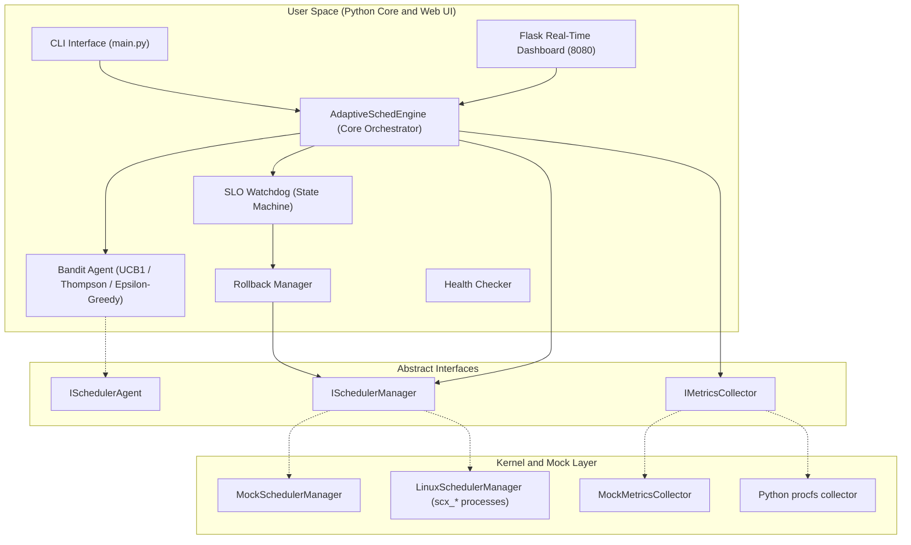

# AdaptiveSched: Self-Tuning CPU Scheduler Selection via Online Bandit Learning and SLO-Aware Rollback

[-blue.svg)](https://github.com/sched-ext/scx)
[]()
[]()

> **Operating Systems Engineering Project**
> School of Computer Science and Engineering (SCOPE), VIT Vellore
> **Team Members:**
> - **Arjun Tyagi** (24BCE0605) -- Core Engine, SLO Watchdog, CLI, Dashboard, Integration
> - **Aritra Ghosh** (24BCE0598) -- Online Bandit Learning Algorithms, Metrics Collectors

---

## Project Overview

Modern operating systems rely on a single, fixed-policy CPU scheduler (e.g., CFS or EEVDF in Linux). However, diverse computing workloads -- ranging from ultra-low-latency gaming and real-time audio to high-throughput compilation and database servers -- exhibit fundamentally conflicting scheduling requirements.

The Linux kernel 6.12 introduced **`sched_ext`**, enabling dynamic, user-space schedulers via eBPF. However, Linux lacks an **autonomous mechanism to choose which scheduler to run**. Existing academic approaches rely on offline hardware calibration tables that cannot generalize to dynamic workloads.

**AdaptiveSched** solves this by treating CPU scheduler selection as an **online multi-armed bandit problem** with an **SLO-aware safety watchdog**:

1. **Online Bandit Agent**: Learns optimal schedulers (`scx_rusty`, `scx_lavd`, `scx_bpfland`, `scx_simple`) on-the-fly using UCB1, Thompson Sampling, or Epsilon-Greedy.
2. **SLO Watchdog and Rollback Engine**: Evaluates system metrics over a rolling window, detects SLO violations, and automatically rolls back to a safe default scheduler.
3. **Interactive Dashboard**: Real-time visualization of metrics, bandit arm statistics, watchdog state, and manual override controls.

---

## Documentation

- [Project Explanation](docs/PROJECT_EXPLANATION.md): Simple, accessible explanation of the project.
- [Demo Guide](docs/DEMO_GUIDE.md): Detailed test cases, expected terminal outputs, and spike demonstration.
- [Product Requirements Document (PRD)](docs/PRD.md): Full functional requirements, mathematical equations, and integration plan.
- [Implementation Status](docs/MVP_STATUS.md): Current implementation state, limitations, and validation checklist.

---

## System Architecture



---

## Work Division and Roles

| Workstream | Owner | Deliverables | Status |
| :--- | :--- | :--- | :--- |
| **Core Engine, Watchdog, CLI, Dashboard** | **Arjun Tyagi** (24BCE0605) | Core engine orchestrator and decision loop, SLO watchdog state machine and rollback manager, interactive web dashboard (Chart.js, dark glassmorphism), rich terminal CLI and command runner, system integration and demo harnesses | Completed |
| **Bandit Learning and Metrics Collection** | **Aritra Ghosh** (24BCE0598) | Python bandit algorithms (UCB1, Thompson Sampling, Epsilon-Greedy), reward computation, mock and Python procfs metrics collectors, Linux process-based sched_ext manager | Completed |

---

## Quick Start

### Install Dependencies

```bash
pip install -r requirements.txt
```

### Launch the Demo Engine

```bash
python run_demo.py
```

Dashboard available at: `http://localhost:8080`

### CLI Commands

```bash
# Start the autonomous agent
python -m src.cli.main start --mode mock --algorithm ucb1 --slo balanced

# Inspect real-time status
python -m src.cli.main status

# Manually switch scheduler
python -m src.cli.main switch scx_rusty

# Switch SLO profile
python -m src.cli.main slo --set interactive

# View switch and rollback audit log
python -m src.cli.main history
```

### Run Tests

```bash
python -m unittest discover -v -s tests
```

---

## Directory Structure

```text
AdaptiveSched/
+-- config/
|   +-- adaptivesched.yaml       # Global runtime configuration
|   +-- slo_profiles/            # SLO specifications (YAML)
|       +-- balanced.yaml
|       +-- interactive.yaml
|       +-- throughput.yaml
+-- docs/
|   +-- PROJECT_EXPLANATION.md   # Simple project explanation
|   +-- PRD.md                   # Requirements and architecture
|   +-- DEMO_GUIDE.md            # Demo instructions
|   +-- MVP_STATUS.md            # Implementation status
|   +-- report/                  # Final report (LaTeX + PDF)
+-- src/
|   +-- agent/                   # Multi-armed bandit agents
|   +-- cli/                     # Rich CLI commands
|   +-- core/                    # Core engine, config loader, data models
|   +-- dashboard/               # Flask dashboard, REST API, templates
|   +-- interfaces/              # Abstract Base Classes
|   +-- metrics/                 # Metrics collectors (mock and Linux /proc)
|   +-- scheduler/               # Scheduler managers (mock and Linux sched_ext)
|   +-- watchdog/                # SLO watchdog, health check, rollback
+-- tests/
|   +-- test_core.py             # Unit test suite (13 tests)
+-- scripts/
|   +-- benchmark_linux.py       # Linux microbenchmark runner
+-- requirements.txt             # Python dependencies
+-- run_demo.py                  # Demo launcher script
```

---

## Authors

- **Arjun Tyagi** (24BCE0605)
- **Aritra Ghosh** (24BCE0598)

School of Computer Science and Engineering (SCOPE)
Vellore Institute of Technology (VIT), Vellore, India
