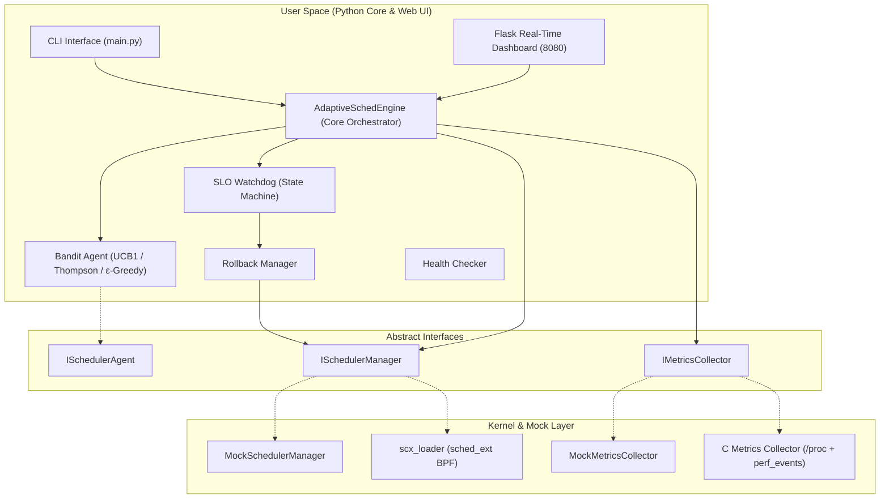

# AdaptiveSched: Self-Tuning CPU Scheduler Selection via Online Bandit Learning and SLO-Aware Rollback

[-blue.svg)](https://github.com/sched-ext/scx)
[]()
[-brightgreen.svg)]()

> **Operating Systems Engineering Project — Review 2**  
> School of Computer Science and Engineering (SCOPE), VIT Vellore  
> **Team Members:**
> - **Arjun Tyagi** (24BCE0605) — Lead: Integration, Watchdog Safety Engine, CLI & Web Dashboard
> - **Aritra Ghosh** (24BCE0598) — Lead: Online Bandit Learning Algorithms, C/eBPF Metrics Collector

---

## 1. Executive Summary

Modern operating systems rely on a single, fixed-policy CPU scheduler (e.g., CFS or EEVDF in Linux). However, diverse computing workloads—ranging from ultra-low-latency gaming and real-time audio to high-throughput compilation and database servers—exhibit fundamentally conflicting scheduling requirements.

The Linux kernel 6.12 introduced **`sched_ext`**, enabling dynamic, user-space schedulers via eBPF. However, Linux lacks an **autonomous mechanism to choose which scheduler to run**. Existing academic approaches rely on offline hardware calibration tables that cannot generalize to dynamic workloads.

**AdaptiveSched** solves this by formulating dynamic scheduling as an **online multi-armed bandit problem** backed by an **SLO-Aware Safety Watchdog**:
1. **Online Bandit Agent**: Learns optimal schedulers (`scx_rusty`, `scx_lavd`, `scx_bpfland`, `scx_simple`) on-the-fly using UCB1, Thompson Sampling, or ε-Greedy.
2. **SLO Watchdog & Rollback Engine**: Continually evaluates latency and CPU load against Service Level Objectives (SLOs). If performance drops or instability occurs, it triggers an **automatic zero-downtime rollback** to the safe default kernel scheduler.
3. **Interactive Visual Dashboard**: A real-time web application streaming scheduling latencies, bandit arm values, throughput, and state transitions.

---

## 2. System Architecture



---

## 3. Work Division & Separation of Concerns

To ensure parallel development and modular isolation, the project is structured with strict interface boundaries:

| Workstream | Owner | Subsystems / Deliverables | Status |
| :--- | :--- | :--- | :--- |
| **Module B: Watchdog, Engine & Interfaces** | **Arjun Tyagi** (24BCE0605) | • Core Engine orchestrator & decision loop<br>• SLO Watchdog state machine & rollback manager<br>• Interactive Web Dashboard (Chart.js, dark glassmorphism)<br>• Rich Terminal CLI & command runner<br>• System integration & demo harnesses | **Completed & Demo-Ready** |
| **Module A: Learning & Kernel Collection** | **Aritra Ghosh** (24BCE0598) | • Multi-armed bandit algorithms (UCB1, Thompson, ε-greedy)<br>• Dynamic reward normalization functions<br>• C-based metrics collector (`/proc/schedstat` & `perf`)<br>• Python ctypes bridge & eBPF scheduler loader | **Planned in [docs/ARITRA_PLAN.md](docs/ARITRA_PLAN.md)** |

*(Mock implementations are currently provided for Module A components, enabling the entire project to run end-to-end on any Windows/Linux machine for Review 2).*

---

## 4. Quick Start — Live Demo

### Option A: One-Click Windows Launcher
Double-click `start_demo.bat` in the project root. This installs requirements, starts the agent in mock mode, and opens the web dashboard in your browser.

### Option B: Command Line

1. **Install Dependencies:**
   ```bash
   pip install -r requirements.txt
   ```

2. **Launch the Demo Engine:**
   ```bash
   python run_demo.py
   ```
   *Dashboard available at:* `http://localhost:8080`

3. **Or run via the CLI directly:**
   ```bash
   # Terminal 1: Run the autonomous agent
   python -m src.cli.main start --mode mock --algorithm ucb1 --slo balanced

   # Terminal 2: Inspect real-time status in rich terminal format
   python -m src.cli.main status

   # Terminal 2: Manually switch scheduler
   python -m src.cli.main switch scx_rusty

   # Terminal 2: Switch SLO profile
   python -m src.cli.main slo --set interactive

   # Terminal 2: View switch and rollback audit log
   python -m src.cli.main history
   ```

---

## 5. Review 2 Demo Script Walkthrough

For a step-by-step presentation flow with dialogue and exact actions, refer to:
- 💡 **[Simple Project Explanation (ELI5)](docs/SIMPLE_EXPLANATION.md)**: Plain-English explanation with analogies, zero jargon, and viva Q&A.
- 📖 **[Presentation Script](docs/PRESENTATION_SCRIPT.md)**: Slide-by-slide 15-minute presentation script.
- 📋 **[Demo Guide](docs/DEMO_GUIDE.md)**: Detailed test cases, expected terminal outputs, and spike demonstration.
- 📐 **[Product Requirements Document (PRD)](docs/PRD.md)**: Full functional requirements, mathematical equations, and integration plan.
- 🛠 **[Aritra's Development Plan](docs/ARITRA_PLAN.md)**: Actionable instructions for Module A development.

### Key Demo Highlights:
1. **Autonomous Learning**: Observe bandit algorithm pulling scheduler arms and adjusting weights.
2. **Interactive Controls**: 1-click manual scheduler selection via web dashboard.
3. **Safety Watchdog in Action**: Click **"Inject Workload Spike"** on the dashboard. Watch latency spike, the watchdog transition from `MONITOR` → `VIOLATION` → `COOLDOWN`, and the system automatically roll back to the safe `default` scheduler without user intervention.

---

## 6. Directory Structure

```text
AdaptiveSched/
├── config/
│   ├── adaptivesched.yaml       # Global runtime configuration
│   └── slo_profiles/            # SLO specifications (YAML)
│       ├── balanced.yaml
│       ├── interactive.yaml
│       └── throughput.yaml
├── docs/
│   ├── SIMPLE_EXPLANATION.md    # Plain-English guide (ELI5 & Viva cheat-sheet)
│   ├── PRD.md                   # Complete Product Requirements Document
│   ├── DEMO_GUIDE.md            # Step-by-step demo instructions
│   ├── PRESENTATION_SCRIPT.md   # Presentation script for Review 2
│   └── ARITRA_PLAN.md           # Implementation plan for teammate (Module A)
├── src/
│   ├── agent/                   # Multi-armed bandit agents (mock & production)
│   ├── cli/                     # Rich CLI commands (start, status, switch, slo, history)
│   ├── core/                    # Core engine, config loader, dataclass models
│   ├── dashboard/               # Flask dashboard, REST API, templates & static CSS/JS
│   ├── interfaces/              # Abstract Base Classes (IMetrics, IScheduler, IAgent)
│   ├── metrics/                 # Metrics collectors (mock & Linux /proc)
│   ├── scheduler/               # Scheduler managers (mock & Linux sched_ext)
│   └── watchdog/                # SLO watchdog, health check, rollback state machine
├── tests/
│   └── test_core.py             # Complete unit test suite
├── paper.tex                    # LaTeX research paper draft
├── requirements.txt             # Python dependencies
├── run_demo.py                  # Demo launcher script
└── start_demo.bat               # 1-click Windows runner
```

---

## 7. Authors & Department

- **Arjun Tyagi** (Registration No: `24BCE0605`)
- **Aritra Ghosh** (Registration No: `24BCE0598`)

Department of Computer Science and Engineering  
School of Computer Science and Engineering (SCOPE)  
Vellore Institute of Technology (VIT), Vellore, India
