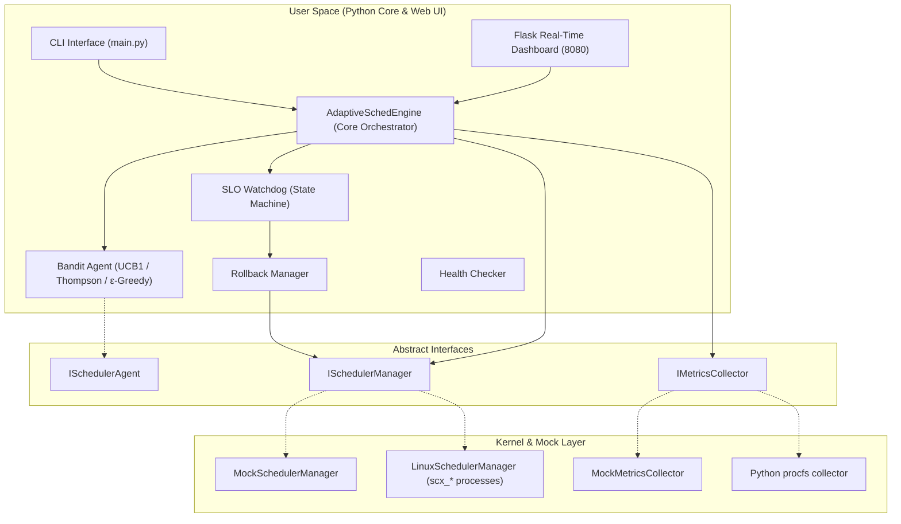

# AdaptiveSched: Self-Tuning CPU Scheduler Selection via Online Bandit Learning and SLO-Aware Rollback

[-blue.svg)](https://github.com/sched-ext/scx)
[]()
[]()

> **Operating Systems Engineering Project — Review 2**  
> School of Computer Science and Engineering (SCOPE), VIT Vellore  
> **Team Members:**
> - **Arjun Tyagi** (24BCE0605) — Lead: Integration, Watchdog Safety Engine, CLI & Web Dashboard
> - **Aritra Ghosh** (24BCE0598) — Lead: Online Bandit Learning Algorithms, C/eBPF Metrics Collector

---

## 0. Refer To these Docs for In-Depth

- [Demo Guide](docs/DEMO_GUIDE.md): Detailed test cases, expected terminal outputs, and spike demonstration.
- [Product Requirements Document (PRD)](docs/PRD.md): Full functional requirements, mathematical equations, and integration plan.
- [Current MVP Status](docs/MVP_STATUS.md): Implemented behavior, limitations, and Linux validation checklist.
- [Earlier Module A Plan](docs/ARITRA_PLAN.md): Historical plan; use the MVP status page for current implementation state.

---

## 1. Executive Summary

Modern operating systems rely on a single, fixed-policy CPU scheduler (e.g., CFS or EEVDF in Linux). However, diverse computing workloads—ranging from ultra-low-latency gaming and real-time audio to high-throughput compilation and database servers—exhibit fundamentally conflicting scheduling requirements.

The Linux kernel 6.12 introduced **`sched_ext`**, enabling dynamic, user-space schedulers via eBPF. However, Linux lacks an **autonomous mechanism to choose which scheduler to run**. Existing academic approaches rely on offline hardware calibration tables that cannot generalize to dynamic workloads.

**AdaptiveSched** is an MVP for exploring scheduler selection with an **online multi-armed bandit** and an **SLO watchdog**. The mock demo is portable; Linux real mode is an early integration path and has not yet been validated on a supported host:
1. **Online Bandit Agent**: Learns optimal schedulers (`scx_rusty`, `scx_lavd`, `scx_bpfland`, `scx_simple`) on-the-fly using UCB1, Thompson Sampling, or ε-Greedy.
2. **SLO Watchdog & Rollback Engine**: Evaluates available metrics over a rolling window. In Linux mode, stopping a manager-owned sched_ext process returns scheduling to the kernel fair scheduler; switching can include a short fair-scheduler interval.
3. **Interactive Dashboard**: Shows metrics and identifies simulated or unavailable values. Workload throughput and p99 latency require workload-specific collection and are not provided by the procfs MVP.

---

## 2. System Architecture



---

## 3. Work Division & Separation of Concerns

To ensure parallel development and modular isolation, the project is structured with strict interface boundaries:

| Workstream | Owner | Subsystems / Deliverables | Status |
| :--- | :--- | :--- | :--- |
| **Module B: Watchdog, Engine & Interfaces** | **Arjun Tyagi** (24BCE0605) | • Core Engine orchestrator & decision loop<br>• SLO Watchdog state machine & rollback manager<br>• Interactive Web Dashboard (Chart.js, dark glassmorphism)<br>• Rich Terminal CLI & command runner<br>• System integration & demo harnesses | **Completed & Demo-Ready** |
| **Module A: Learning & Kernel Collection** | **Aritra Ghosh** (24BCE0598) | • Python bandit algorithms and reward computation<br>• Mock and Python procfs metrics<br>• Linux process-based sched_ext manager<br>• C/perf collector, ctypes bridge, and Linux host validation | **Algorithms and Linux MVP implemented; host validation and C/perf work remain** |

*(The default demo uses simulation and does not change the host scheduler. Real mode is Linux-only and requires root plus supported sched_ext binaries.)*

---

## 4. Quick Start — Live Demo

### Option A: One-Click Windows Launcher
Double-click `start_demo.bat` in the project root. This installs requirements, starts the agent in mock mode, and opens the web dashboard in your browser.

### Option B: Command Line

1. **Install Dependencies:**
   ```bash
   pip install -r requirements.txt
   ```

2. **Launch the Demo Engine:**
   ```bash
   python run_demo.py
   ```
   *Dashboard available at:* `http://localhost:8080`

3. **Or run via the CLI directly:**
   ```bash
   # Terminal 1: Run the autonomous agent
   python -m src.cli.main start --mode mock --algorithm ucb1 --slo balanced

   # Terminal 2: Inspect real-time status in rich terminal format
   python -m src.cli.main status

   # Terminal 2: Manually switch scheduler
   python -m src.cli.main switch scx_rusty

   # Terminal 2: Switch SLO profile
   python -m src.cli.main slo --set interactive

   # Terminal 2: View switch and rollback audit log
   python -m src.cli.main history
   ```

4. **Linux real-mode MVP** (Linux kernel with `CONFIG_SCHED_CLASS_EXT`, installed `scx_*` binaries, and root privileges):
   ```bash
   sudo python -m src.cli.main start --mode real --algorithm ucb1 --slo balanced
   ```
   See [MVP Status](docs/MVP_STATUS.md) for measurements, safety boundaries, and the required validation steps. Real mode reports average run-queue wait, not p99 workload latency; throughput is unavailable without a workload probe.

5. **Repeatable Linux microbenchmark** (same Linux prerequisites):
   ```bash
   sudo python scripts/benchmark_linux.py --schedulers default scx_rusty scx_lavd --duration 30 --repeats 3 --output results/benchmark.json
   ```
   This compares one fixed CPU workload and records metadata, per-trial samples, and median changes against `default`. It is a microbenchmark; application workloads still need separate evaluation.

---

## 5. Review 2 Demo Script Walkthrough

For the mock demo walkthrough, see the [Demo Guide](docs/DEMO_GUIDE.md). For current implementation boundaries, see [MVP Status](docs/MVP_STATUS.md) and the [PRD](docs/PRD.md).

### Key Demo Highlights:
1. **Autonomous Learning**: Observe bandit algorithm pulling scheduler arms and adjusting weights.
2. **Interactive Controls**: 1-click manual scheduler selection via web dashboard.
3. **Safety Watchdog in Action**: Click **"Inject Workload Spike"** on the dashboard. Watch latency spike, the watchdog transition from `MONITOR` → `VIOLATION` → `COOLDOWN`, and the system automatically roll back to the safe `default` scheduler without user intervention.

---

## 6. Directory Structure

```text
AdaptiveSched/
├── config/
│   ├── adaptivesched.yaml       # Global runtime configuration
│   └── slo_profiles/            # SLO specifications (YAML)
│       ├── balanced.yaml
│       ├── interactive.yaml
│       └── throughput.yaml
├── docs/
│   ├── PRD.md                   # Requirements and architecture
│   ├── DEMO_GUIDE.md            # Mock demo instructions
│   ├── MVP_STATUS.md            # Current implementation and limits
│   └── ARITRA_PLAN.md           # Historical Module A plan
├── src/
│   ├── agent/                   # Multi-armed bandit agents (mock & production)
│   ├── cli/                     # Rich CLI commands (start, status, switch, slo, history)
│   ├── core/                    # Core engine, config loader, dataclass models
│   ├── dashboard/               # Flask dashboard, REST API, templates & static CSS/JS
│   ├── interfaces/              # Abstract Base Classes (IMetrics, IScheduler, IAgent)
│   ├── metrics/                 # Metrics collectors (mock & Linux /proc)
│   ├── scheduler/               # Scheduler managers (mock & Linux sched_ext)
│   └── watchdog/                # SLO watchdog, health check, rollback state machine
├── tests/
│   └── test_core.py             # Complete unit test suite
├── paper.tex                    # LaTeX research paper draft
├── requirements.txt             # Python dependencies
├── run_demo.py                  # Demo launcher script
└── start_demo.bat               # 1-click Windows runner
```

---

## 7. Authors & Department

- **Arjun Tyagi** (Registration No: `24BCE0605`)
- **Aritra Ghosh** (Registration No: `24BCE0598`)

School of Computer Science and Engineering (SCOPE)  
Vellore Institute of Technology (VIT), Vellore, India
