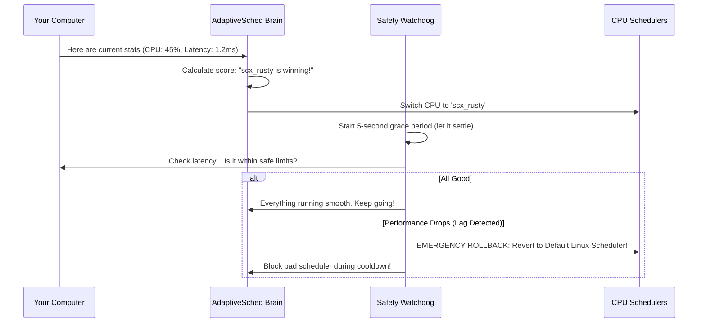

# AdaptiveSched — Project Explained in Plain English

> **A quick, simple guide to understanding AdaptiveSched without confusing jargon.**  
> Perfect for quick review, viva preparation, and explaining the project to anyone in 2 minutes.

---

## 1. The 30-Second Summary (Explain Like I'm 5)

Imagine you are driving a car, but your car **only has 3rd gear**.
- On a highway, it’s okay.
- Going uphill, it struggles.
- In heavy city traffic, it stalls.

Right now, your computer’s operating system (like Linux or Windows) does something very similar: **it uses only one single CPU scheduler** to manage every task on your computer. 

Whether you are playing a fast-paced video game, rendering a 4K movie, or just opening Chrome, the computer manages them all with the exact same scheduling policy.

**What we built:**  
**AdaptiveSched** is like an **automatic gear shifter for your CPU**. It constantly watches what your computer is doing, picks the best scheduling policy for the moment, and if a scheduler ever messes up or lags, it **instantly switches back to safety** before you even notice.

---

## 2. Why Are We Building This? (The Problem)

### Different tasks need completely different treatment:
1. **Gaming / Interactive Apps:** Needs **instant reaction time (low latency)**. If you click your mouse and the game responds 50 milliseconds late, it feels laggy.
2. **Video Editing / Compiling Code:** Needs **raw brute-force throughput**. You don't care if a background task waits a tiny fraction of a second, as long as 100% of the CPU power finishes rendering the video faster.
3. **Web Servers:** Needs to balance **thousands of tiny requests** at the same time without dropping any.

### What changed recently in Linux?
In late 2024, Linux Kernel 6.12 added a new feature called **`sched_ext`**. For the first time in history, Linux allows programmers to plug in different schedulers while the computer is running, without restarting!

### The missing piece:
Linux gave us the ability to switch schedulers, **but it didn't give us a brain to decide *when* or *which one* to switch to!**  
Users still had to guess manually. That is the exact problem we set out to solve.

---

## 3. What Are We Building?

AdaptiveSched is a lightweight, smart program running in the background. It consists of three main parts:

```text
 ┌────────────────────────────────────────────────────────┐
 │                      THE SENSOR                        │
 │  Watches CPU usage, delay (latency), and speed (speed) │
 └───────────────────────────┬────────────────────────────┘
                             │
                             ▼
 ┌────────────────────────────────────────────────────────┐
 │                       THE BRAIN                        │
 │    Learns which scheduler gives the best performance   │
 │         (Like learning which slot machine pays best)   │
 └───────────────────────────┬────────────────────────────┘
                             │
                             ▼
 ┌────────────────────────────────────────────────────────┐
 │                   THE SAFETY GUARD                     │
 │   "Did latency spike? Roll back to default instantly!" │
 └────────────────────────────────────────────────────────┘
```

1. **The Sensor (Metrics Collector):** Constantly measures how the CPU is doing (how much delay there is, how many tasks are getting completed).
2. **The Brain (Online Bandit Learner):** Tries different schedulers, sees how well they perform, and learns in real-time which one works best.
3. **The Safety Guard (SLO Watchdog):** Sets a clear rule (e.g., *"delay must never exceed 5 milliseconds"*). If a scheduler misbehaves, the watchdog immediately kicks it out and switches back to the safe default scheduler.
4. **The Dashboard & CLI:** A visual web screen with live graphs so you can see the decisions happening in real-time.

---

## 4. How It Works (Step-by-Step)

Here is what happens every few seconds inside AdaptiveSched:



### Step 1: Gathering Clues
Every second, AdaptiveSched checks the computer's vital signs:
- How busy is the CPU?
- How long are tasks waiting in line before they get CPU time?
- How much work is getting done per second?

### Step 2: The "Slot Machine" Brain (Bandit Algorithm)
How does it pick a scheduler without being told ahead of time?
Think of a casino with 5 slot machines (each represents a different scheduler):
- You don't know which machine pays the most.
- At first, you pull each arm once or twice to test the waters (**Exploration**).
- When you find one that pays well, you play it more often (**Exploitation**).
- But you occasionally re-check the other machines in case the workload changed.

This is called a **Multi-Armed Bandit (MAB)** algorithm. It doesn't need weeks of heavy AI training—it learns **live** while your computer is running!

### Step 3: The Safety Net (SLO Watchdog)
What if the algorithm tries a scheduler that completely freezes or slows down your game?
This is where the **Watchdog** acts like an airbag:
- You set a Service Level Objective (SLO), for example: *"Never let latency cross 5,000 microseconds."*
- If the current scheduler crosses that line 3 times in a row, the Watchdog yells **"STOP!"**
- It **automatically forces the computer back to the standard safe default scheduler** (`CFS/EEVDF`).
- It puts the bad scheduler in "time-out" (cooldown) so it won't pick it again right away.

---

## 5. Why Is Our Approach Better?

| Old / Other Research Approaches | AdaptiveSched (Our Project) |
|---|---|
| **Requires heavy offline machine learning** (takes hours/days of training on specific hardware). | **Zero offline training.** Learns on the fly on any computer. |
| **No safety net.** If an experimental scheduler lags or hangs, your system freezes. | **Automatic rollback.** The Watchdog guarantees your computer never stays in a degraded state. |
| **Hardware specific.** A model trained on an Intel laptop fails on an AMD desktop. | **Adapts automatically** to whatever hardware it runs on. |
| **Black box.** Hard to tell what it is doing. | **Live Web Dashboard & CLI** showing real-time decisions, latency graphs, and switch history. |

---

## 6. Who Did What? (Separation of Work)

To ensure this project was built cleanly and properly divided between teammates:

### 👤 Arjun Tyagi (24BCE0605) — Lead: Safety, Control & System Integration
- **The SLO Watchdog:** Built the safety state machine, violation detector, and automatic rollback engine.
- **The Core Engine:** Built the orchestrator loop that connects everything together.
- **The Web Dashboard:** Built the real-time dark-mode web interface with live Chart.js graphs.
- **The Command Line (CLI):** Built the `status`, `switch`, `slo`, and `history` terminal commands.

### 👤 Aritra Ghosh (24BCE0598) — Lead: Learning & Low-Level Collection
- **The Bandit Algorithms:** Mathematical formulation and code for UCB1, Thompson Sampling, and $\epsilon$-Greedy.
- **The Reward Function:** Formulating how latency, throughput, and CPU usage are converted into a single score ($0.0$ to $1.0$).
- **The C Metrics Collector:** C program reading directly from `/proc/schedstat` and `perf_event_open()`.
- **The Kernel Bridge:** The `ctypes` bridge connecting low-level C data to high-level Python logic.

*(Note: For the Review 2 demo, mock versions of the C collector and algorithms are in place so the full project runs smoothly and safely on any laptop).*

---

## 7. Typical Review / Viva Questions (And Simple Answers!)

### Q1: "What is sched_ext?"
> **Answer:** *"It's a feature added in Linux 6.12 that allows user-space programs to load custom CPU schedulers written in BPF without having to recompile or reboot the kernel."*

### Q2: "What is a Multi-Armed Bandit and why use it instead of Deep Learning?"
> **Answer:** *"A Multi-Armed Bandit is an online learning algorithm that balances trying new things (exploration) with choosing the best-known option (exploitation). We use it because it requires zero pre-training, has almost zero CPU overhead, and adapts in seconds to changing workloads."*

### Q3: "What happens if a newly selected scheduler performs terribly?"
> **Answer:** *"Our SLO Watchdog monitors performance every cycle. If latency exceeds our pre-set threshold 3 times in a row, it immediately triggers an automatic rollback to the standard Linux default scheduler, ensuring the computer never lags or crashes."*

### Q4: "How do you define an SLO?"
> **Answer:** *"An SLO (Service Level Objective) is defined in a simple YAML configuration file. For example, for gaming, we specify that P99 scheduling latency must stay below 3,000 microseconds."*

### Q5: "What is the role of the Grace Period?"
> **Answer:** *"When you switch CPU schedulers, there is a momentary blip while queues rebalance. The grace period gives the new scheduler 5 seconds to warm up before the watchdog starts judging its performance."*
